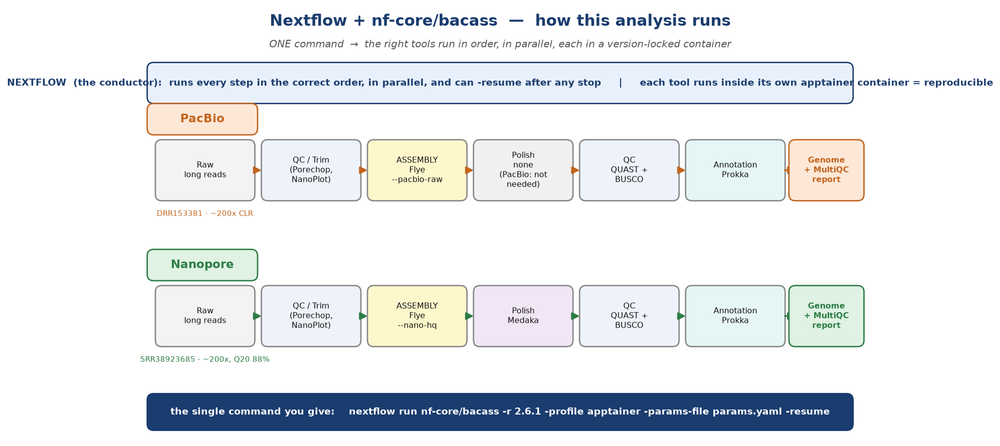
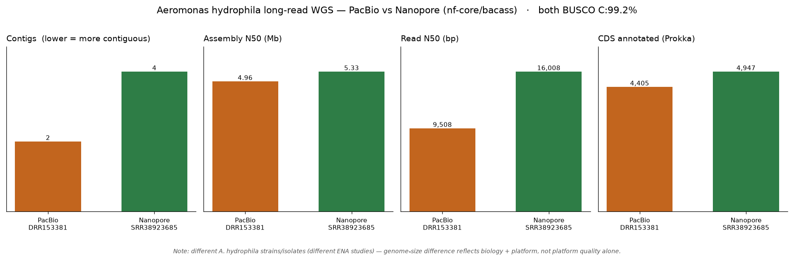

# aeromonas-hydrophila-pacbio-wgs

**Long-read whole-genome assembly & annotation of *Aeromonas hydrophila***
*PacBio CLR (Sequel)* · ENA run `DRR153381` · pipeline **nf-core/bacass 2.6.1** (Nextflow + Apptainer)

> এটি একটি hands-on long-read bacterial WGS practice project — public data দিয়ে
> standard nf-core workflow শেখা। এই repo-তে code, config, run script, result summary
> ও workflow documentation আছে (raw reads ও বড় intermediate ফাইল track করা হয়নি)।

---

## 1. লক্ষ্য / Objective
একটি fish-pathogenic bacterium (*Aeromonas hydrophila*, motile aeromonad septicaemia-র কারণ)
এর **PacBio (Sequel CLR)** long-read data দিয়ে genome **assembly → polish → QC → annotation**
সম্পন্ন করা, একটি reproducible Nextflow pipeline দিয়ে।

একই পদ্ধতিতে অন্য platform-টিও আলাদা repo-তে করা হয়েছে → **`aeromonas-hydrophila-nanopore-wgs`** (nf-core/bacass,
run `SRR38923685`), যাতে PacBio ও Nanopore পাশাপাশি তুলনা করা যায়।

## 2. Data
| | |
|---|---|
| Organism | *Aeromonas hydrophila* |
| Platform | PacBio CLR (Sequel) |
| ENA run | [`DRR153381`](https://www.ebi.ac.uk/ena/browser/view/DRR153381) |
| Reads | 139,663 |
| Read N50 | 9,508 bp |
| Coverage | ~201x (~4.7–5.4 Mb genome) |

## 3. Workflow — Nextflow + nf-core/bacass


**Nextflow** হলো pipeline "conductor": সে প্রতিটা tool সঠিক ক্রমে, parallel-ভাবে, আর
প্রতিটিকে একটি version-locked **apptainer container**-এ চালায় → সম্পূর্ণ reproducible।
`-resume` দিলে মাঝপথে থামলেও যেখানে ছিল সেখান থেকে চলে।

এই (PacBio) run-এর ধাপগুলো:
1. **QC / trim** — Porechop (adapter) + NanoPlot (read-length/quality plots)
2. **Assembly** — `Flye --pacbio-raw`
3. **Polishing** — **none** — PacBio reads-এ ONT-এর Medaka ব্যবহার করা হয় না; Flye-র নিজস্ব consensus যথেষ্ট
4. **Assembly QC** — QUAST (contiguity) + BUSCO (gene completeness, `bacteria_odb10`)
5. **Annotation** — Prokka (CDS, rRNA, tRNA)
6. **Report** — MultiQC (`results/multiqc_report.html`)

### কীভাবে চালানো হয়েছে / How to run
```bash
nextflow run nf-core/bacass -r 2.6.1 \
  -profile apptainer \
  -c config/run.config \
  -params-file config/params.yaml \
  -work-dir work -resume
```
সব parameter `config/params.yaml`-এ; samplesheet `config/samplesheet.tsv`
(long-read only → R1/R2/Fast5 = `NA`, শুধু `LongFastQ`)।

## 4. ফলাফল / Results
| Metric | Value |
|---|---|
| Contigs | **2** |
| Total length | 4,997,227 bp |
| Largest contig | 4,958,012 bp |
| Assembly N50 | 4,958,012 bp |
| GC content | 61.05% |
| BUSCO | C:99.2%[S:97.6%,D:1.6%],F:0.0%,M:0.8% (bacteria_odb10, n=124) |
| CDS / tRNA / rRNA (Prokka) | 4,405 / 125 / 31 |

ফাইল: `results/assembly/` (genome FASTA), `results/qc/` (QUAST + BUSCO + read stats),
`results/annotation/` (Prokka `.gff` + stats), `results/multiqc_report.html`।

## 5. PacBio vs Nanopore তুলনা


দুটো genome **ভিন্ন isolate/strain** (ভিন্ন ENA study) — তাই genome-size পার্থক্য
শুধু platform নয়, biology-ও। তবে QC metric (contiguity, BUSCO) তুলনাযোগ্য:
দুটোতেই **BUSCO C:99.2%**; PacBio CLR + Flye খুব কম contig দিয়েছে, Nanopore (longer read N50)
বড় chromosome এক contig-এ বসিয়েছে। বিস্তারিত: `docs/comparison.csv`।

## 6. শেখার পয়েন্ট / Lessons (real-world troubleshooting)
- **ToulligQC ONT-only** — PacBio run-এ এটা fail করে; `skip_toulligqc: true` দিয়ে বাদ দিতে হয়। nf-core/bacass মূলত ONT-কেন্দ্রিক।
- **Container pull timeout** — বড় image (QUAST) default 20m timeout ছাড়ালে `apptainer.pullTimeout` বাড়াতে হয়; image আগে থেকে cache করলে দুটো run-ই দ্রুত পায়।
- **`-params-file` ব্যবহার** — CLI-তে `--flye_mode '--pacbio-raw'`-এর double-dash value nextflow ভুল পার্স করে; YAML params-file দিলে সমস্যা নেই।
- **`-resume`-এর শক্তি** — step fail করলে Flye আবার চালাতে হয় না, আটকে থাকা step থেকে চলে।

## 7. Tools / Versions
Nextflow 26.04 · nf-core/bacass 2.6.1 · Apptainer 1.1.9 · Flye 2.9.5 ·
QUAST 5.3.0 · BUSCO 5.8.3 (bacteria_odb10) · Prokka · MultiQC 1.32 · seqkit 2.1.0

## 8. Reproduce
```bash
# 1. data (ENA)
wget -c https://ftp.sra.ebi.ac.uk/vol1/fastq/DRR153/DRR153381/DRR153381_subreads.fastq.gz
# 2. samplesheet → config/samplesheet.tsv  (LongFastQ = path to the fastq.gz)
# 3. run (see §3)
```

---
*License: MIT. Data: public ENA records (see §2). Analysis by [@BariSayed](https://github.com/BariSayed).*
